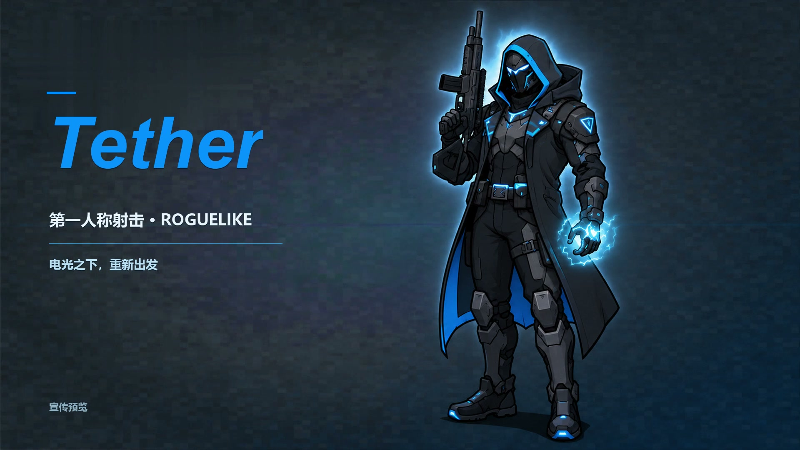

# Tether — 宣传片

[在线播放](https://candle98.github.io/Tether-promo/) · [下载 MP4](https://candle98.github.io/Tether-promo/assets/tether-trailer.mp4)

Tether 是一款使用 Unreal Engine 5 开发的第一人称射击 Roguelike。宣传片展示当前项目的电光蓝视觉、兜帽角色、城市场景与 Boss 场景。

宣传片长 36 秒，采用 1920×1080、30fps 画面与配乐。视频由项目现有动画、游戏场景截图及项目配乐剪辑制作；截图段使用轻微推近，并在画面中标注“游戏画面截图”。

## 仓库内容

- `assets/tether-trailer.mp4`：1080p 宣传片，H.264 视频与 AAC 音频。
- `assets/poster.jpg`：宣传片封面。
- `index.html`：可直接播放与下载视频的静态页面。

本仓库仅包含宣传成片与播放页面，不包含 Unreal 项目源文件或原始音频素材。

## 来源

游戏基于 [Draklif/Wired](https://github.com/Draklif/Wired) 项目继续制作。现有角色编辑与蓝色主题资源用于本次 Tether 宣传展示。素材权利归各自权利人所有，本仓库不对第三方素材另行授予许可。

页面通过 GitHub Pages 从 `main` 分支根目录发布。
